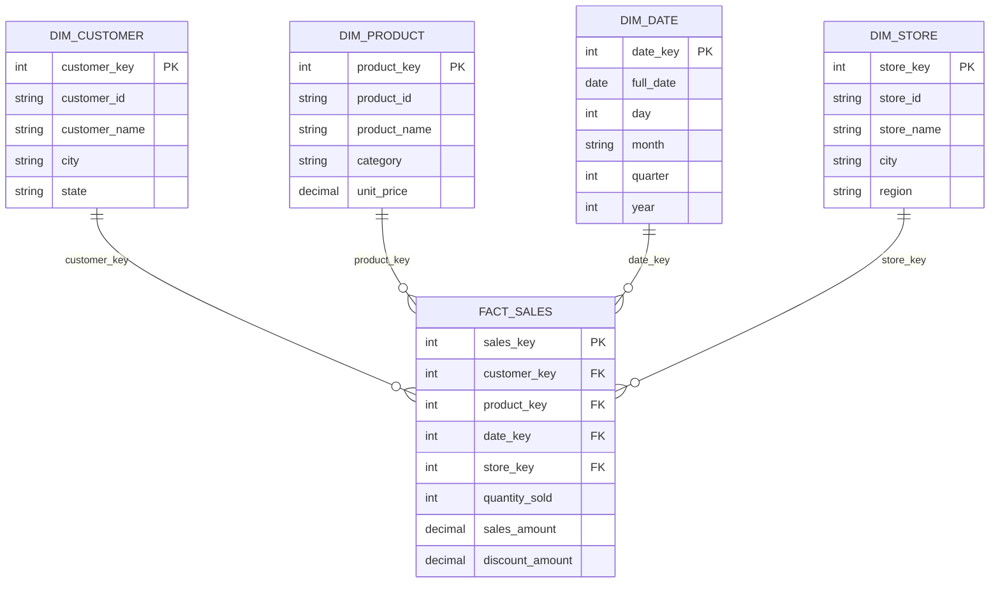
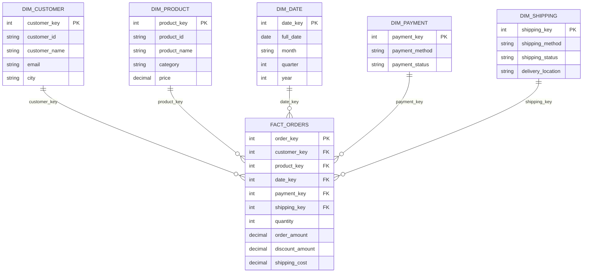
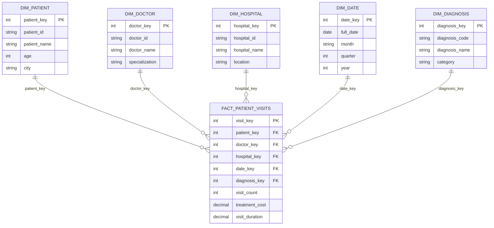

# Day 11 – Star Schema Designs
## Data Warehouse and Dimensional Modeling

**Task:** Design Star Schemas for Sales, E-commerce, and Healthcare Data Warehouses.

**Tools:** Visual Studio Code, Markdown, PostgreSQL (for optional implementation)

---

# 1. Introduction

A Star Schema is a dimensional data modeling technique used in Data Warehousing. It contains one central Fact Table connected to multiple Dimension Tables.

The Fact Table stores measurable business information, while Dimension Tables store descriptive information used for analysis and reporting.

### Objectives

- Understand Star Schema architecture.
- Identify Fact Tables and Dimension Tables.
- Understand primary keys and foreign keys.
- Design data warehouse schemas for different business domains.
- Understand how dimensional modeling supports analytical reporting.

---

# 2. Sales Data Warehouse – Star Schema

## 2.1 Project Overview

The Sales Data Warehouse is designed to analyze sales transactions, customer purchases, product performance, and store performance.

## 2.2 Schema Diagram

## 2.3 Fact Table

**Table Name:** `fact_sales`

Purpose: Stores sales transaction measurements.

Measures:
- Quantity sold
- Sales amount
- Discount amount
- Total sales amount

Foreign Keys:
- customer_key
- product_key
- date_key
- store_key

## 2.4 Dimension Tables

| Dimension | Description |
|---|---|
| dim_customer | Stores customer details |
| dim_product | Stores product details |
| dim_date | Stores date, month, quarter, and year |
| dim_store | Stores store and location details |

## 2.5 Business Benefits

- Analyze total sales by product.
- Identify top-performing customers.
- Compare sales across stores.
- Analyze monthly and yearly sales trends.

---

# 3. E-commerce Data Warehouse – Star Schema

## 3.1 Project Overview

The E-commerce Data Warehouse is designed to analyze online orders, customer purchases, product performance, payment methods, and shipping details.

## 3.2 Schema Diagram

## 3.3 Fact Table

**Table Name:** `fact_orders`

Purpose: Stores online order measurements.

Measures:
- Order amount
- Quantity purchased
- Discount amount
- Shipping cost

Foreign Keys:
- customer_key
- product_key
- date_key
- payment_key
- shipping_key

## 3.4 Dimension Tables

| Dimension | Description |
|---|---|
| dim_customer | Customer information |
| dim_product | Product information |
| dim_date | Order date information |
| dim_payment | Payment method and status |
| dim_shipping | Shipping method and delivery details |

## 3.5 Business Benefits

- Analyze online sales.
- Identify popular products.
- Understand customer purchasing patterns.
- Compare payment methods.
- Monitor shipping performance.

---

# 4. Healthcare Data Warehouse – Star Schema

## 4.1 Project Overview

The Healthcare Data Warehouse is designed to analyze patient visits, doctor performance, hospital operations, treatment costs, and diagnosis information.

## 4.2 Schema Diagram

## 4.3 Fact Table

**Table Name:** `fact_patient_visits`

Purpose: Stores patient visit measurements and treatment information.

Measures:
- Visit count
- Treatment cost
- Visit duration

Foreign Keys:
- patient_key
- doctor_key
- hospital_key
- date_key
- diagnosis_key

## 4.4 Dimension Tables

| Dimension | Description |
|---|---|
| dim_patient | Patient information |
| dim_doctor | Doctor and specialization details |
| dim_hospital | Hospital and location details |
| dim_date | Visit date information |
| dim_diagnosis | Diagnosis and category information |

## 4.5 Business Benefits

- Analyze patient visit trends.
- Compare hospital performance.
- Understand treatment costs.
- Analyze diagnosis patterns.
- Monitor doctor and department workloads.

---

# 5. Comparison of the Three Star Schemas

| Feature | Sales | E-commerce | Healthcare |
|---|---|---|---|
| Fact Table | fact_sales | fact_orders | fact_patient_visits |
| Main Analysis | Sales performance | Online orders | Patient visits |
| Number of Dimensions | 4 | 5 | 5 |
| Key Measures | Sales, quantity, discount | Orders, amount, shipping cost | Visits, treatment cost, duration |

---

# 6. Important Data Warehouse Concepts

### Fact Table
A Fact Table stores measurable business events, such as sales amounts, order quantities, and treatment costs.

### Dimension Table
A Dimension Table stores descriptive information, such as customer, product, date, and location details.

### Primary Key
A Primary Key uniquely identifies each record in a table.

### Foreign Key
A Foreign Key connects a Fact Table to its related Dimension Table.

### Surrogate Key
A Surrogate Key is an artificial key generated to uniquely identify a dimension record.

### Natural Key
A Natural Key is an identifier that comes from a source business system, such as a customer ID.

### Grain
Grain defines exactly what one row in a Fact Table represents.

Examples:
- Sales: One row per product sold in a transaction.
- E-commerce: One row per product line in an order.
- Healthcare: One row per patient visit and diagnosis.

---

# 7. Conclusion

In this task, three Star Schema designs were prepared for Sales, E-commerce, and Healthcare Data Warehouses.

The designs identify Fact Tables, Dimension Tables, primary keys, foreign keys, and business measures. They demonstrate how dimensional modeling organizes data for reporting and analytical queries.

This exercise improved my understanding of Data Warehouse architecture and how Star Schemas support business intelligence and data analysis.